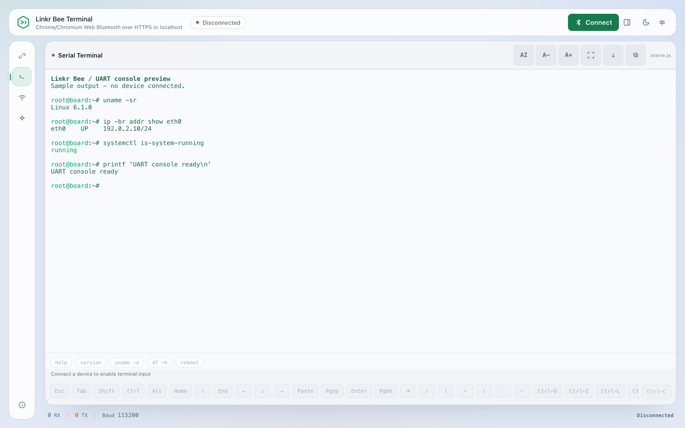

<p align="center">
  <picture>
    <source media="(prefers-color-scheme: dark)" srcset="assets/linkr-bee-logo-dark.svg">
    
  </picture>
</p>

<p align="center">
  A wireless serial console for your board, over Bluetooth LE or your local network.
</p>

<p align="center">
  <a href="https://github.com/radxa/linkr-bee/stargazers"></a>
  <a href="https://github.com/radxa/linkr-bee/actions/workflows/build.yml"></a>
  <a href="https://github.com/radxa/linkr-bee/actions/workflows/linkr-tui.yml"></a>
</p>

<p align="center">
  <a href="README.zh-CN.md">中文</a> ·
  <a href="docs/USAGE.md">User guide</a> ·
  <a href="docs/README.md">Documentation</a> ·
  <a href="docs/DEVELOPMENT.md">Development guide</a>
</p>

Linkr Bee is a small ESP32 accessory that puts a board's UART console on a browser,
a phone, or a command line, over Bluetooth LE or your local network.

UART is usually the last interface still working: board bring-up, bootloader work,
a network that will not come up, recovery. Linkr Bee keeps that console reachable
without a USB serial cable and a computer parked next to the target. It carries the
target's own UART bytes and does not replace the target shell.

## What it does

- Terminal in the browser, in the phone apps, or on the command line, with ANSI and
  256-color output.
- Board panel on the Linkr Bee X1.0: RGB status LED, isolated optocoupler
  contact, NEC remote send/receive, IR learning with slots and names stored
  on the board, a board-stored AI prompt, and an optional board-stored AI
  configuration (endpoint, model, limits; the key stays on the host unless
  explicitly saved).
- Change baud rate, data bits, parity, stop bits, and flow control while connected.
  Default is `115200,8,n,1,n`.
- Send Enter as raw, CR, LF, or CRLF for bootloaders and different shells.
- Save logs, upload them to WebDAV, and check firmware, UART buffer, WiFi, and
  transfer counters from the diagnostics panel.
- Give each paired host a display label (for example "Alice's phone"), stored on
  the board by identity address. The web and phone editors report the browser's
  OS once when the board stores none, the TUI reports the local user name once
  for this host, and the owner can always edit or clear it.
- Join a 2.4 GHz network and keep using the console over LAN, without Bluetooth.
- Assistant in the browser and the phone apps: searches the serial log, runs
  target commands under a selectable approval policy, and asks before changing
  the bridge's UART, WiFi or log-upload settings. It remembers facts
  about each target between sessions, counts the tokens it used, and can export
  the whole diagnosis as a Markdown report.
- Android app as an MCP server and A2A agent on the local network, so Claude
  Desktop, Cursor, and other AI clients can read the console and — under a
  selectable access mode (read-only, every command needs approval, only
  high-risk commands need approval, or fully authorized) — send input and
  change settings, or delegate a task to the app's resident assistant. See the
  [MCP server guide](docs/MCP.md) and the [A2A guide](docs/A2A.md).

### Pairing labels from the command line

The board's own I/O help is `@linkr aux`; the core list is `@h` / `@linkr
help`. A pairing label travels hex-encoded UTF-8:

```sh
bee-cli --query-bonds
bee-cli --rename-bond 0/AA:BB:CC:DD:EE:01="Alice's phone"
bee-cli --remove-bond 0/AA:BB:CC:DD:EE:01
bee-cli query bonds
bee-cli bond 0/AA:BB:CC:DD:EE:01 "Alice's phone"
bee-cli unbond 0/AA:BB:CC:DD:EE:01
```

`@linkr bonds label <type>/<address>` reads one label back; adding `<hex>` or
`clear` writes or clears it under the control-owner gate. Labels are display
only, are at most 48 UTF-8 bytes, and are deleted with the pairing.

## Choose a client

All clients reach the same accessory; choose the workflow that suits your host.

| Client | Best for | Guide |
| --- | --- | --- |
| Web terminal | A desktop browser, without installing a client | [User guide](docs/USAGE.md) |
| Rust CLI / TUI | A keyboard-first desktop console, scripts, and agent sessions | [Host terminal](tools/linkr-tui/README.md) |
| Android / iOS app | Native BLE with the shared touch terminal: drag to scroll, tap to type, long press for phone-style selection handles and copy | [Mobile app](mobile/README.md) |
| HarmonyOS NEXT app | Phone and tablet layouts with a native BLE host | [HarmonyOS client](harmonyos/README.md) |
| Python / C terminal | Existing desktop scripts and Linux / Buildroot integration | [Terminal tools](docs/DEVELOPMENT.md#ble-terminal) |

RISC-V 64-bit and LoongArch64 Linux are prospective CLI/TUI ports, not published
v0.1 targets. See the [architecture assessment](docs/CLI_ARCHITECTURES.zh-CN.md)
(Chinese) for dependencies and remaining build/runtime validation.

The mobile screenshots below show the shared responsive web UI, not proof of a
physical-device test. See each platform guide for its validation status.

## What you need

```text
Browser / desktop / mobile / Linkr
                 │
          Bluetooth LE or WiFi
                 │
        Linkr Bee accessory (ESP32-C3 / ESP32-C5)
                 │
             3.3 V UART
                 │
        SBC or embedded target
```

- A Linkr Bee accessory: Linkr Bee X1.0 (MV013), ESP32-C3 Super Mini,
  ESP32-C3 DevKitM, ESP32-C3 DevKitC, or ESP32-C5 DevKitC.
- A target with a UART console, and three wires: target TX to accessory RX, target RX
  to accessory TX, and a shared ground.
- A host running a compatible browser, a desktop terminal client, or a phone app
  from the table above.

The UART side is 3.3 V logic, not RS-232. See the
[hardware requirements](docs/HARDWARE.md) before wiring a custom board.

## Getting started

1. Flash the accessory. Download the image for your board (names are listed in the
   [development guide](docs/DEVELOPMENT.md#github-actions-build)) and flash it from
   macOS or Linux:

   ```sh
   python3 -m pip install esptool
   ./flash_firmware.sh
   ```

   The script finds the image and the serial port, verifies `SHA256SUMS` when it is
   present, and keeps the saved settings. Building from source is covered in the
   [development guide](docs/DEVELOPMENT.md#build).

2. Wire it to the target, crossing TX and RX and connecting ground. On an ESP32-C3
   Super Mini the bridge uses GPIO20 (RX) and GPIO21 (TX); other boards are in the
   [hardware requirements](docs/HARDWARE.md#3-引脚分配). On the Linkr Bee X1.0 the
   target plugs into J7: pin 1 RX, pin 2 TX, pin 3 GND, pin 4 optional 5 V in.

3. Power both sides. The activity LED flashes while bytes cross the bridge on
   every board (WROOM: GPIO2; Linkr Bee X1.0: the single-wire RGB LED on GPIO8).
   On the X1.0, `@l`, `@o` and `@r` also expose that LED, an isolated dry
   contact, and an NEC IR remote; see the
   [X1.0 hardware notes](docs/BEE_X1.0_HARDWARE.md#5-板载外设与固件命令). On WROOM the optional autobaud key is GPIO13;
   it is used only when `CONFIG_LINKR_BLE_BRIDGE_UART_AUTOBAUD=y` (off in the
   default build).

4. Authorize this host if the board requires it: press the pairing key once
   (**GPIO1** on C3/C5, **USER_KEY/GPIO3** on the Linkr Bee X1.0) and connect
   within 30 seconds, then accept the pairing prompt. The window is
   `CONFIG_LINKR_BLE_BRIDGE_PAIRING_GRACE_MS` (30 s by default), so the key does
   not have to be held for the whole exchange. WROOM ships with pairing
   authorization disabled, so no GPIO4 press is needed; enable
   `CONFIG_LINKR_BLE_BRIDGE_PAIRING_GPIO_AUTH=y` to require it.

5. Open a client. For the web terminal:

   ```sh
   tools/serve_web.sh        # then open http://127.0.0.1:8765/
   ```

6. Match the UART format to the target, then reset it and watch the console.

## Using the terminal



*English UI preview with sample UART output; no hardware connection is shown.*

- Top bar: connection state, connect/disconnect, panel toggle, theme, language.
- Terminal: click and type; its toolbar opens the assistant and provides font
  size, fullscreen, scroll-to-bottom, and copy. Clear and log export are in settings.
- Settings: the left rail opens connection, serial, network, assistant, and About
  sections. Close the panel to give the terminal more space.

<details>
  <summary>Serial settings beside the terminal</summary>


</details>

UART settings apply immediately, so a target that boots at an unusual baud rate
needs no reflash. In the browser, the terminal keeps the target's window size in
sync after login and on layout changes, which full-screen programs need. Native
phone apps instead resize only their local view when the soft keyboard opens, so
the remote tty keeps its current size. If output arrives but typing does nothing,
check that the target RX goes to the accessory TX, and turn hardware flow control
off unless CTS and RTS are both wired.

<p align="center">
  
</p>

On phones and tablets the terminal stays central, settings open in a drawer, and
the accessory key row provides Esc, Tab, arrows, and Ctrl combinations. The
assistant adapts between stacked and side-by-side layouts as space allows.

## Serial assistant

Use your own model endpoint to inspect logs, collect target evidence, and propose
commands. **Auto** is the default: recognized low-risk queries can run at a detected
shell prompt, while other input needs approval. **Manual** asks for every input;
**Full Auto** is time-limited and still guards recognized destructive commands.
These checks are not a shell sandbox.

Model requests go directly from your host to the provider you choose. The API key
is stored in plaintext local storage and sent to that provider when required, not
to the accessory or a Linkr-operated relay. Review the endpoint and any sensitive
serial output before enabling the assistant.

See the [user guide](docs/USAGE.md#serial-assistant) for setup, execution modes,
logging, and privacy. Build and implementation details stay in the platform and
development guides.

## LAN mode

After provisioning the accessory onto a 2.4 GHz network over Bluetooth LE, the same
terminal can reach it through its WebSocket bridge. Bluetooth LE stays the
configuration path: UART settings, WiFi, WebDAV, and diagnostics are managed over
it, while LAN mode carries the terminal data.

The bridge needs a 128-bit access token, generated on first boot and readable only
over the encrypted Bluetooth LE link. The web terminal picks it up automatically
while Bluetooth is connected; the Python and C terminals print it. The token gates
access but does not encrypt anything, so `ws://` traffic is visible on the same
network. Use LAN mode on a network you trust.

## Pairing and security

- The Bluetooth LE link is encrypted and bonded. On C3/C5 each new host is
  authorized once by pressing **GPIO1** to GND and connecting within 30 seconds
  (**GPIO3/USER_KEY** on the Linkr Bee X1.0); the press opens the window, the
  key does not have to stay held. WROOM disables the physical pairing check by
  default; GPIO4 is optional when
  `CONFIG_LINKR_BLE_BRIDGE_PAIRING_GPIO_AUTH=y` is enabled.
- Eight hosts are remembered across reboots and are not evicted automatically, so
  remove an unused host or factory-reset before adding a ninth.
- Pairing uses LE Secure Connections Just Works, which has no man-in-the-middle
  protection. Authorize only where you can see the accessory.
- Factory reset clears every bond and setting. Hold **GPIO0 to GND** on ESP32-C3, or
  **GPIO28** on ESP32-C5, while the board boots, for at least two seconds. On an
  ESP32-C3 Super Mini the BOOT pin is not GPIO0, so check the board wiring first.
- Per-client steps and recovery: [Bluetooth pairing](docs/BLE_PAIRING.md) (Chinese).

## Troubleshooting

| Symptom | Check |
| --- | --- |
| No device in the client | Accessory powered and in range, and not already connected to another host; only one Bluetooth LE connection is served at a time |
| Browser cannot connect | Chrome or Chromium, served over HTTPS or `localhost`. `tools/serve_web.sh` uses `localhost` |
| No output | Target TX to accessory RX, target is printing, baud rate matches |
| Output but no input | Target RX to accessory TX; hardware flow control off unless CTS and RTS are both wired |
| Garbled output | UART format matches the target: baud rate, data bits, parity, stop bits |
| No pairing prompt | On C3/C5, press GPIO1 then connect within 30 s (Linkr Bee X1.0: GPIO3/USER_KEY); press again if the window expired. WROOM needs no GPIO press unless its optional pairing check is enabled |
| LAN mode fails | Accessory on 2.4 GHz, host on the same network, token matches the one reported over Bluetooth LE |

## Limits

- Current firmware is matched by the Linkr Management Service, not by its
  advertised name. The default name is `Linkr Bee XXXX`, where `XXXX` is the
  last four hex digits of the hardware MAC (for example
  `58:BF:25:33:07:8C` → `078C`); custom names are display-only and can be set
  with `@n`. The TUI and Web clients also accept the fixed
  `Linkr BLE UART...` name of pre-service, NUS-only firmware as a terminal-only
  compatibility fallback; a `Linkr Bee...` name without the service is refused.
- Web Bluetooth means Chrome or Chromium. Safari and Firefox do not implement it.
- WiFi provisioning is 2.4 GHz only.
- iOS simulators cannot do Bluetooth LE; use a real device.

## Documentation

- [User guide](docs/USAGE.md): interface tour, serial input, assistant, LAN, and logging
- [Rust CLI / TUI](tools/linkr-tui/README.md): desktop terminal and automation
- [Development guide](docs/DEVELOPMENT.md): build, flash, packaging, Kconfig, protocol
- [Hardware requirements](docs/HARDWARE.md): pinout, electrical, production notes (Chinese)
- [Bluetooth pairing](docs/BLE_PAIRING.md): authorization and recovery (Chinese)
- [BLE accessory API](docs/LINKR_BLE_API.zh-CN.md): services and framing for integrators (Chinese)
- [Android / iOS](mobile/README.md) and [HarmonyOS](harmonyos/README.md) clients
- [Documentation index](docs/README.md) · [中文 README](README.zh-CN.md)

## License

[LICENSE](LICENSE)
