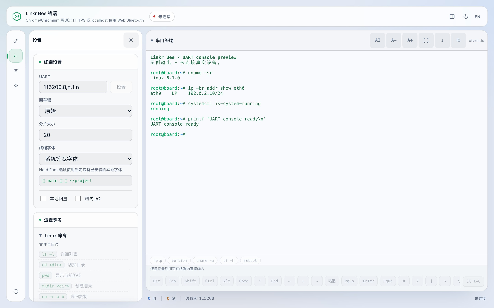
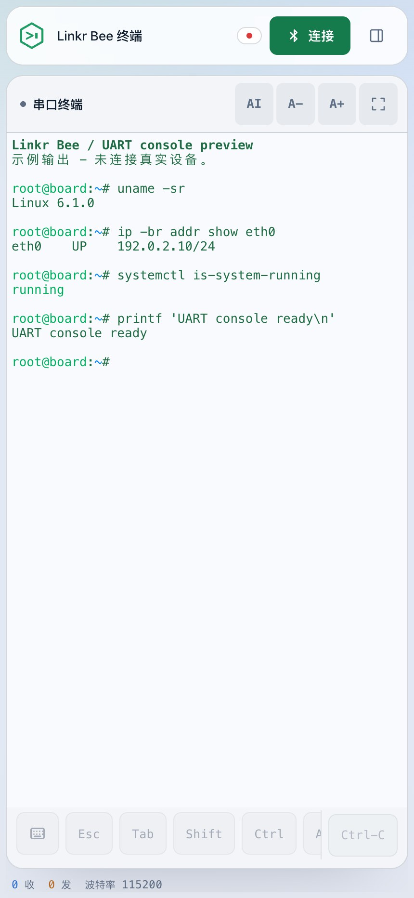

<p align="center">
  <picture>
    <source media="(prefers-color-scheme: dark)" srcset="assets/linkr-bee-logo-dark.svg">
    
  </picture>
</p>

<p align="center">
  通过蓝牙或局域网把开发板的串口控制台搬到浏览器、手机和命令行。
</p>

<p align="center">
  <a href="https://github.com/radxa/linkr-bee/stargazers"></a>
  <a href="https://github.com/radxa/linkr-bee/actions/workflows/build.yml"></a>
  <a href="https://github.com/radxa/linkr-bee/actions/workflows/linkr-tui.yml"></a>
</p>

<p align="center">
  <a href="README.md">English</a> ·
  <a href="docs/USAGE.zh-CN.md">使用指南</a> ·
  <a href="docs/README.zh-CN.md">文档索引</a> ·
  <a href="docs/DEVELOPMENT.zh-CN.md">开发指南</a>
</p>

Linkr Bee 是一个 ESP32 小配件，把目标板的 UART 控制台通过蓝牙或局域网接到浏览器、
手机和命令行。

UART 常常是最后一个还能用的入口：新板启动、Bootloader 调试、网络起不来、系统恢复。
Linkr Bee 让这条控制台随时可连，不用常驻一根 USB 串口线、也不用把电脑守在目标设备旁。
它只转发目标 UART 的原始字节，不替代目标系统的 Shell。

## 能做什么

- 浏览器、手机 App、命令行三种终端，支持 ANSI 彩色与 256 色。
- 连接状态下改波特率、数据位、校验位、停止位和流控，默认 `115200,8,n,1,n`。
- 回车可按 raw、CR、LF、CRLF 发送，适配 Bootloader 和不同 Shell。
- 日志导出、WebDAV 上传，诊断面板可查固件、UART 缓冲、WiFi 和收发计数。
- 接入 2.4 GHz 网络后走局域网，不再需要蓝牙。
- 浏览器和手机 App 内置助手：检索串口日志，按所选审批策略执行目标命令；修改桥接器
  自身的 UART、WiFi 和日志上传设置前需确认。它会记住每台目标设备的事实、统计
  本轮消耗的 token，并可以把整个排查过程导出成 Markdown 报告。

## 选择客户端

各客户端访问的是同一个配件，按主机和工作方式选择即可。

| 客户端 | 适合场景 | 说明 |
| --- | --- | --- |
| Web 终端 | 桌面浏览器直接使用，无需安装客户端 | [使用指南](docs/USAGE.zh-CN.md) |
| Rust CLI / TUI | 键盘操作、桌面终端、脚本与 Agent 会话 | [主机终端](tools/linkr-tui/README.md)（英文） |
| Android / iOS App | 原生 BLE 与共享触控终端 | [移动端](mobile/README.md)（英文） |
| HarmonyOS NEXT App | 手机和平板布局、原生 BLE 宿主 | [鸿蒙客户端](harmonyos/README.md)（英文） |
| Python / C 终端 | 现有桌面脚本与 Linux / Buildroot 集成 | [终端工具](docs/DEVELOPMENT.zh-CN.md#ble-终端) |

RISC-V 64 位和 LoongArch64 Linux 的 CLI/TUI 移植具备基础条件，尚未提供 v0.1 安装包。
依赖、构建缺口与待验证项见[架构支持评估](docs/CLI_ARCHITECTURES.zh-CN.md)。

下方手机截图展示共享 Web 界面的响应式布局，不代表已完成对应平台的真机验证；各端
验证范围见平台文档。

## 需要什么

```text
浏览器 / 电脑 / 手机 / Linkr
              │
        Bluetooth LE 或 WiFi
              │
      Linkr Bee 配件（ESP32-C3 / ESP32-C5）
              │
           3.3 V UART
              │
        SBC 或嵌入式设备
```

- 一台 Linkr Bee 配件：ESP32-C3 Super Mini、ESP32-C3 DevKitM、ESP32-C3 DevKitC
  或 ESP32-C5 DevKitC。
- 一台带 UART 控制台的目标设备，三根线：目标 TX 接配件 RX、目标 RX 接配件 TX、共地。
- 一台运行兼容浏览器、桌面终端客户端或手机 App 的主机，按上表选择。

UART 一侧是 3.3 V 逻辑电平，不是 RS-232。自行设计硬件前先看
[硬件需求](docs/HARDWARE.md)。

## 快速开始

1. 刷固件。下载对应开发板的镜像（文件名见
   [开发指南](docs/DEVELOPMENT.zh-CN.md#github-actions-构建与刷写)），在 macOS 或
   Linux 上执行：

   ```sh
   python3 -m pip install esptool
   ./flash_firmware.sh
   ```

   脚本会自动找镜像和串口，有 `SHA256SUMS` 时校验，并保留已保存的设置。从源码构建见
   [开发指南](docs/DEVELOPMENT.zh-CN.md#构建)。

2. 接线：交叉连接 TX/RX，并连接 GND。ESP32-C3 Super Mini 上桥接 UART 为 GPIO20 (RX)
   和 GPIO21 (TX)，其他板子见[硬件需求](docs/HARDWARE.md#3-引脚分配)。

3. 给两侧上电。所有板子在串口收发数据时都会让板载蓝灯闪烁（WROOM 为 GPIO2）。
   WROOM 的自动波特率按键为 GPIO13，只在
   `CONFIG_LINKR_BLE_BRIDGE_UART_AUTOBAUD=y` 时使用（默认构建关闭）。

4. 需要物理授权的板型，把配对 GPIO 接地（C3/C5 为 **GPIO1**），连接并接受系统
   配对提示，完成后释放。WROOM 默认关闭配对授权，不需要按 GPIO4；如需启用，
   打开 `CONFIG_LINKR_BLE_BRIDGE_PAIRING_GPIO_AUTH=y`。这台主机会被记住。

5. 打开客户端。Web 终端：

   ```sh
   tools/serve_web.sh        # 然后打开 http://127.0.0.1:8765/
   ```

6. 把 UART 格式设成和目标一致，复位目标设备，看控制台输出。

## 使用说明


*中文界面预览，终端内容为示例 UART 输出，未连接真实设备。*

- 顶部栏：连接状态、连接 / 断开、面板开关、主题、语言。
- 终端：点进去直接输入，工具栏提供助手入口、字号、全屏、滚动到底部与复制；清屏和
  日志导出在设置中。
- 设置面板：左侧导航分别打开连接、串口、网络、助手与关于页面；关闭面板可把空间
  留给终端。

<details>
  <summary>展开查看终端旁的串口设置</summary>



</details>

UART 参数改完立即生效，目标机用非标准波特率启动时不用重新刷固件。终端还会在登录后和
窗口变化时同步目标机的窗口大小，全屏程序依赖这个。如果有输出但输入没反应，先确认目标
RX 接的是配件 TX，并且除非 CTS 和 RTS 都接了，否则关掉硬件流控。

<p align="center">
  
</p>

手机和平板上终端优先占用空间，设置收进抽屉；终端附加按键提供 Esc、Tab、方向键和
Ctrl 组合。助手根据可用空间切换为上下排列或左右分栏。

## 串口助手

使用自己的模型端点检索日志、收集目标证据并提出命令。默认 **Auto**：检测到 Shell
提示符时可直接执行识别出的低风险查询，其他输入需要审批；**手动** 对每次输入确认；
**Full Auto** 有时间限制，识别出的破坏性命令仍需确认。这些检查不是 Shell 沙箱。

模型请求从主机直接发往所选接入商。API Key 明文保存在本地存储，按需发送给该接入商，
不会交给配件或 Linkr 中转服务。开启前请确认端点，并检查串口日志中是否含敏感信息。

配置、执行档位、日志与隐私说明见[使用指南](docs/USAGE.zh-CN.md#串口助手)。构建与
实现细节保留在平台文档和开发指南中。

## 局域网模式

配件通过蓝牙配网接入 2.4 GHz 网络后，同一个终端可以改用它的 WebSocket 桥接访问。蓝牙
仍然是配置入口：UART 参数、WiFi、WebDAV 和诊断都走蓝牙，局域网模式只承载终端数据。

桥接需要 128 位访问令牌，首次启动生成，只能通过加密的蓝牙通道读到。Web 终端在蓝牙
连接期间自动获取，Python 和 C 终端会打印出来。令牌只控制访问、不做加密，`ws://` 流量
在同网段可见，请在可信网络里使用局域网模式。

## 配对与安全

- 蓝牙链路要求加密和绑定。C3/C5 每台新主机配对时把 **GPIO1** 接地授权一次；
  WROOM 默认关闭物理授权，不需要按 GPIO4，启用
  `CONFIG_LINKR_BLE_BRIDGE_PAIRING_GPIO_AUTH=y` 后才要求拉低 GPIO4。
- 最多记住八台主机，重启后保留，不会自动淘汰旧主机；要加第九台，先删掉不用的或恢复
  出厂。
- 配对使用 LE Secure Connections Just Works，没有中间人身份核验，只在能看见配件的
  场合授权。
- 恢复出厂会清除全部绑定和设置：ESP32-C3 启动时把 **GPIO0 接地**，ESP32-C5 用
  **GPIO28**，持续至少两秒。ESP32-C3 Super Mini 的 BOOT 按键不是 GPIO0，先确认板级
  接线。
- 各客户端步骤与恢复方法：[蓝牙配对与恢复](docs/BLE_PAIRING.md)。

## 常见问题

| 现象 | 检查 |
| --- | --- |
| 客户端里找不到设备 | 配件已上电、在范围内，且没有连到别的主机；同一时刻只服务一条蓝牙连接 |
| 浏览器连不上 | 用 Chrome 或 Chromium，且通过 HTTPS 或 `localhost` 打开；`tools/serve_web.sh` 用的就是 `localhost` |
| 没有输出 | 目标 TX 接了配件 RX、目标确实在输出、波特率一致 |
| 有输出但输入没反应 | 目标 RX 接了配件 TX；除非 CTS 和 RTS 都接了，否则关掉硬件流控 |
| 输出乱码 | UART 格式与目标一致：波特率、数据位、校验位、停止位 |
| 没有配对提示 | C3/C5 在连接前把 GPIO1 接地；WROOM 默认不需要按 GPIO，除非启用了可选的配对授权 |
| 局域网模式连不上 | 配件在 2.4 GHz 网络上、主机同网段、令牌与蓝牙通道读到的一致 |

## 已知限制

- 设备按 Linkr Management Service 匹配，不依赖广播名。默认名为
  `Linkr Bee XXXX`，`XXXX` 是硬件 MAC 最后四位十六进制（例如
  `58:BF:25:33:07:8C` → `078C`）；自定义名只用于显示，可用 `@n` 设置。
- Web Bluetooth 只有 Chrome 和 Chromium 支持，Safari 和 Firefox 没有该接口。
- WiFi 配网仅支持 2.4 GHz。
- iOS 模拟器不支持 BLE，需要真机。

## 文档

- [使用指南](docs/USAGE.zh-CN.md)：界面、串口输入、助手、局域网与日志
- [Rust CLI / TUI](tools/linkr-tui/README.md)：桌面终端与自动化（英文）
- [开发指南](docs/DEVELOPMENT.zh-CN.md)：构建、刷写、打包、Kconfig、协议
- [硬件需求](docs/HARDWARE.md)：引脚、电气要求、量产注意事项
- [蓝牙配对与恢复](docs/BLE_PAIRING.md)：授权、绑定与恢复
- [BLE 配件 API](docs/LINKR_BLE_API.zh-CN.md)：服务与分帧，面向集成方
- 手机客户端：[Android / iOS](mobile/README.md) · [HarmonyOS](harmonyos/README.md)
- [文档索引](docs/README.zh-CN.md) · [English README](README.md)

## 许可证

[LICENSE](LICENSE)
